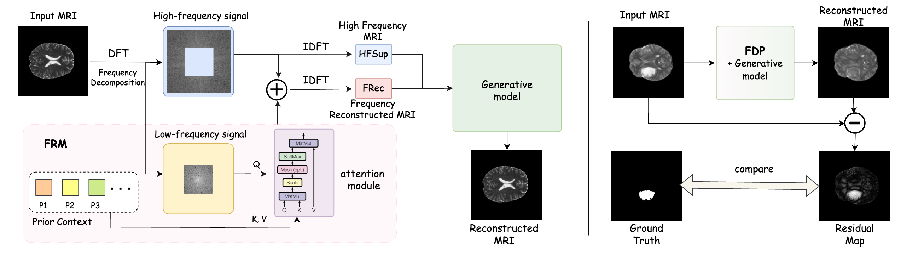

# FDP — Frequency-Decomposition Preprocessing for Unsupervised Anomaly Detection in Brain MRI

> **FDP: A Frequency-Decomposition Preprocessing Pipeline for Unsupervised Anomaly Detection in Brain MRI**
> AAAI 2026



FDP is a plug-and-play preprocessing module that suppresses lesion-related low-frequency content in MRI by replacing it with a healthy reconstruction sampled from a learned prior context bank, then outputs two conditioning signals for a downstream generative model.

---

## Key Insight

MRI lesions (tumours, MS plaques, …) appear as smooth, homogeneous regions → they live primarily in **low-frequency** Fourier components.
Healthy brain anatomy shares **consistent** low-frequency patterns across subjects.
FDP exploits both: remove the low-freq lesion signal, reconstruct it from a healthy prior, and feed the result into the generative model.

---

## Project Structure

```
FDP/
├── fdp/                        # FDP module (standalone, no LDM dependency)
│   ├── ops.py                  # Pure FFT operations
│   ├── module.py               # FDPModule — FRM attention + full pipeline
│   ├── train.py                # Stage-1 training
│   ├── init_prior.py           # k-means++ prior initialisation
│   ├── preprocess.py           # Batch preprocessing → save frec / hf_supp
│   └── data/dataset.py         # MRIDataset (NIfTI loader)
│
├── ldm/                        # Latent Diffusion Model
│   ├── models/
│   │   ├── autoencoder.py      # KL-VAE
│   │   └── diffusion/
│   │       ├── ddpm.py         # Base LatentDiffusion
│   │       └── mri_ldm.py      # MRILatentDiffusion (uses FDPModule as cond_stage)
│   └── data/mri.py             # MRI data loaders for LDM training
│
├── configs/
│   ├── fdp/                    # Stage-1 config
│   ├── vae/                    # Stage-2 config
│   ├── ldm/                    # Stage-3 config
│   └── eval/                   # Inference config
│
├── preload/                    # k-means++ prior banks (generate with fdp/init_prior.py)
├── scripts/sample_vis.py       # Visual sampling tool
├── run_pipeline.sh             # One-command full training pipeline
└── main.py                     # LDM training / evaluation entry point
```

---

## Environment

```bash
conda env create -f environment.yaml
conda activate FDP
```

`environment.yaml` pins the full dependency set (Python 3.12, PyTorch 2.10+cu130, pytorch-lightning 2.6).
The `-e .` entry installs the project in editable mode automatically.

If you prefer to install manually:

```bash
conda create -n FDP python=3.12
conda activate FDP
pip install torch torchvision torchaudio --index-url https://download.pytorch.org/whl/cu130
pip install pytorch-lightning omegaconf nibabel scikit-image einops transformers taming-transformers
pip install -e .
```

Requires CUDA GPUs with ≥ 11 GB VRAM. The default configuration targets 4 GPUs; see [GPU selection](#gpu-selection) to run with fewer.

---

## Datasets

- [IXI](https://brain-development.org/ixi-dataset/) — healthy T2 MRI, Stage-1 training
- [BraTS2020](https://www.med.upenn.edu/cbica/brats2020/) — brain tumour, evaluation
- [BraTS2021](http://braintumorsegmentation.org/)
- [MSLUB](https://lit.fe.uni-lj.si/en/research/resources/3D-MR-MS/)
- [MSSEG-2](https://portal.fli-iam.irisa.fr/msseg-2/)

Expected layout:
```
data/IXI-T2-hd/          ← skull-stripped, flat directory, *-T2.nii.gz
data/BraTS/BraTS2020/    ← nested per-subject directories, *_t2.nii
```

---

## Training Pipeline

### Stage 0 — Prior bank generation (one-time)

The `preload/` directory holds k-means++ prior banks consumed by Stage-1.
They are **not tracked by git** — generate them once before the first run:

```bash
python fdp/init_prior.py \
    --data_root data/IXI-T2-hd \
    --output_dir preload \
    --n_prior 128 \
    --lf_ratio 0.3
# add --minibatch for a faster (slightly less accurate) run
```

### Stages 1–3 + Eval

```bash
bash run_pipeline.sh        # full pipeline: FDP → VAE → LDM → Eval
```

Outputs land under `logs/TIMESTAMP_full_pipeline/{fdp,vae,ldm,eval_results}/`.

### GPU selection

```bash
bash run_pipeline.sh              # default: GPUs 0,1,2,3
bash run_pipeline.sh fdp 0,1     # positional arg
GPU_LIST=0,1 bash run_pipeline.sh # env var
```

### Single-stage mode

Set `PRETRAIN_*` checkpoint paths at the top of `run_pipeline.sh`, then:

```bash
bash run_pipeline.sh fdp   # Stage-1: train FRM only
bash run_pipeline.sh vae   # Stage-2: train VAE  (requires PRETRAIN_FDP_CKPT)
bash run_pipeline.sh ldm   # Stage-3: train LDM  (requires PRETRAIN_FDP_CKPT + PRETRAIN_VAE_CKPT)
bash run_pipeline.sh eval  # Evaluation          (requires all three PRETRAIN_* set)
```

| Mode | `PRETRAIN_FDP_CKPT` | `PRETRAIN_VAE_CKPT` | `PRETRAIN_LDM_CKPT` |
|------|---------------------|---------------------|---------------------|
| full pipeline | ignored | ignored | ignored |
| `fdp` | optional (init weights) | — | — |
| `vae` | **required** | optional (resume) | — |
| `ldm` | **required** | **required** | optional (resume) |
| `eval` | **required** | **required** | optional (auto-find) |

---

## Visual Sampling

`scripts/sample_vis.py` generates a PNG grid for quick quality checks; called automatically by `run_pipeline.sh` after each stage.

```bash
# FDP  [Input | frec | hf_supp]
CUDA_VISIBLE_DEVICES=0 python scripts/sample_vis.py fdp \
    --ckpt logs/<run>/fdp/checkpoints --out_dir logs/<run>/fdp --n 6

# VAE  [Input | VAE(Input) | |Diff| | frec | VAE(frec) | hf_supp | VAE(hf_supp)]
CUDA_VISIBLE_DEVICES=0 python scripts/sample_vis.py vae \
    --ckpt logs/<run>/vae/checkpoints/last.ckpt \
    --config logs/<run>/vae/configs/vae_pipeline.yaml \
    --out_dir logs/<run>/vae --n 6

# LDM  [Input | frec | LDM-rec | |Diff|]
CUDA_VISIBLE_DEVICES=0 python scripts/sample_vis.py ldm \
    --ckpt logs/<run>/ldm/checkpoints \
    --config logs/<run>/ldm/configs/ldm_pipeline.yaml \
    --out_dir logs/<run>/ldm --n 6
```

Passing a directory as `--ckpt` auto-selects `best.ckpt` → `last.ckpt`.
All modes accept `--data_root` to switch datasets (e.g. `data/BraTS/...` for anomaly evaluation).

---

## Using FDPModule in Your Own Code

```python
import torch
from fdp import FDPModule

fdp = FDPModule.from_checkpoint("logs/<run>/fdp/checkpoints/best.ckpt").eval().cuda()

x = ...  # (N, 1, 256, 256) MRI slice in [-1, 1]
with torch.no_grad():
    frec, hf_supp = fdp(x)
    # frec    — frequency-reconstructed healthy MRI  (low-freq conditioning)
    # hf_supp — high-frequency supplement            (structural conditioning)

# After generative reconstruction:
result = fdp.enhance(x, reconstruction)  # amplitude-alignment
```

---

## FDP Pipeline

```
Input MRI  x
    │
    ├─ FFT → low-freq patch fl  ──→  FRM cross-attention (prior bank P) → f̂l
    │
    ├─ MERGE(f̂l, original high-freq) → IDFT → frec     (low-freq conditioning)
    │
    └─ High-pass filter → hf_supp                       (high-freq conditioning)

LDM(frec_latent ⊕ hf_supp_latent) → reconstruction
Residual map: |x - enhance(x, reconstruction)|  → anomaly score
```

---

## Acknowledgements

We thank [Claude](https://claude.ai) (Anthropic) for assistance with code organisation and documentation.

---

## A Note to Future Researchers

We recognise that our exploration of this direction is far from exhaustive, and that the frequency-decomposition idea and the FRM design leave substantial room for deeper investigation. We share this codebase hoping it serves as a concrete, reproducible starting point for others who wish to build on, challenge, or fundamentally rethink these ideas. If it saves you time or sparks a new direction, that is reward enough.

---

## Citation

```bibtex
@inproceedings{li2026fdp,
  title={FDP: A Frequency-Decomposition Preprocessing Pipeline for Unsupervised Anomaly Detection in Brain MRI},
  author={Li, Hao and Zhuang, Zhenfeng and Lin, Jingyu and Liu, Yu and Chen, Yifei and Peng, Qiong and Yu, Lequan and Wang, Liansheng},
  booktitle={Proceedings of the AAAI Conference on Artificial Intelligence},
  volume={40},
  number={8},
  pages={6118--6126},
  year={2026}
}
```
